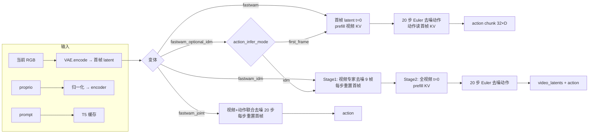

# FastWAM 代码分析文档

> 本文基于仓库当前 `main` 分支代码整理，回答四个问题：
> 1. FastWAM 的模型架构是什么？
> 2. 训练数据是什么形式、模型输出什么结果？
> 3. 训练 / 推理时流过模型的数据分别是什么？训练是否需要分多个阶段？
> 4. action 到底应该用 delta 还是 absolute？代码在哪里做（或不做）这个转换？

---

## 0. 结论速览（TL;DR）

| 问题 | 结论 |
|---|---|
| 架构 | **MoT（Mixture-of-Transformers）双专家**：Wan2.2-TI2V-5B 视频 DiT（30 层，hidden 3072）+ ActionDiT 动作专家（30 层，hidden 1024）。每层两个专家各算 Q/K/V，拼接后做**一次联合 self-attention**，再各自过 FFN。 |
| 输入 | 多相机 RGB 视频（33 帧 obs → 抽 9 帧送 VAE）、动作序列（32 步）、本体状态（只用第 0 帧）、文本指令（T5 embedding + 1 个 proprio token）。 |
| 输出 | 两路 flow-matching 速度场：视频 latent 速度 `[B,48,T_lat,H/16,W/16]` 和动作速度 `[B,32,action_dim]`。推理时只取动作，或先用视频专家"想象未来"再出动作（IDM）。 |
| 训练阶段 | **单阶段端到端**。一次 forward 同时算视频 loss + 动作 loss。没有"先训视频再训动作"的分阶段训练。Optional-IDM 也是在**同一次训练**里随机切换两种注意力掩码来同时支持两种推理模式。 |
| delta / absolute | **框架不强制、也不自动转换**。训练用的就是数据集里 `action` 列（经过可选 `action_state_transforms` 和归一化）。官方 LIBERO 数据是 **delta EEF pose + 绝对 gripper**；RoboTwin 是 **绝对关节角 qpos**。想让绝对动作变 delta：`train_custom.sh --delta-action[-dims ...]`（生成 `delta_action_dims`，processor 自动挂 `RelativeActionTransform`），或手动在 `action_state_transforms` 里配 `RelativePoseTransform` / `RelativeJointTransform`。 |

---

## 1. 模型架构

### 1.1 整体结构

FastWAM 在 Wan2.2-TI2V-5B 的 DiT 旁边并联了一个动作专家 ActionDiT，用 MoT 的方式在每一层做混合注意力。核心类在 `src/fastwam/models/wan22/fastwam.py:18`。

```
                    文本指令 ──T5──► context [B,128,4096]
                                        + proprio token [B,1,4096]
                                                │
        ┌───────────────────────────────────────┴────────────────────────────┐
        │                          MoT (30 层)                                 │
        │                                                                       │
        │  ┌──────────────────────┐          ┌──────────────────────┐          │
        │  │  Video Expert         │          │  Action Expert        │          │
        │  │  Wan2.2 DiT           │          │  ActionDiT            │          │
        │  │  hidden 3072          │          │  hidden 1024          │          │
        │  │  ffn 14336            │          │  ffn 4096             │          │
        │  │  24 heads × 128       │          │  24 heads × 128       │          │
        │  └──────────┬───────────┘          └──────────┬───────────┘          │
        │             │ q,k,v                             │ q,k,v                │
        │             └──────────► concat ◄───────────────┘                     │
        │                           │                                           │
        │                    joint self-attn                                    │
        │                    (flash / SDPA)                                     │
        │                           │                                           │
        │             ┌─────────────┴─────────────┐                             │
        │             ▼                           ▼                             │
        │      video post-block            action post-block                    │
        │      (gate + text cross-attn + MLP)  (gate + text cross-attn + MLP)   │
        └───────────────────────────────────────────────────────────────────────┘
```

关键点：

- 两个专家**层数、头数、head_dim 必须一致**（都是 30 / 24 / 128），MoT 在 `mot.py:15` 构造时强校验。
- 每一层只做一次 self-attention，视频 token 和动作 token 在**同一个序列**里互相可见（可见范围由 attention mask 控制，见 §1.4）。
- 每个专家 attention 之后还有自己的 **post-block**：门控残差 + 对文本 context 的 cross-attention + MLP（`mot.py:106` 的 `_apply_expert_post_block`）。
- 两个专家的 hidden_dim 不同，所以 Q/K/V 的投影矩阵不同，但 attention 的 head_dim 相同，因此可以拼在一起算。

### 1.2 视频专家（Wan2.2-TI2V-5B）

配置见 `configs/model/fastwam*.yaml`，实现见 `src/fastwam/models/wan22/wan_video_dit.py:309`。

| 项 | 值 |
|---|---|
| hidden_dim | 3072 |
| ffn_dim | 14336 |
| num_layers | 30 |
| num_heads × attn_head_dim | 24 × 128 |
| patch_size | `[1,2,2]`（时间不 patch，空间 2×2） |
| in_dim / out_dim | 48（VAE latent 通道数） |
| freq_dim | 256 |
| text_dim | 4096 |
| `seperated_timestep` | true |
| `fuse_vae_embedding_in_latents` | true（首帧 latent 走 t=0 的干净通路） |

**首帧特殊处理**：当 `fuse_vae_embedding_in_latents=true` 时，`prepare` 会把第一个 latent 帧的 token 时间步设为 0（`wan_video_dit.py:640` 附近），即"首帧永远是干净的观测"，后续帧才是待去噪的未来。这是 first-frame / IDM 两种推理模式能成立的基础。

### 1.3 动作专家（ActionDiT）

实现在 `src/fastwam/models/wan22/action_dit.py:31`。

| 项 | 值 |
|---|---|
| hidden_dim | 1024 |
| ffn_dim | 4096 |
| num_layers | 30 |
| num_heads × attn_head_dim | 24 × 128 |
| 输入投影 | `action_encoder: Linear(action_dim → 1024)` |
| 输出头 | `head: Linear(1024 → action_dim)` |
| 位置编码 | 1D RoPE（`precompute_freqs_cis(attn_head_dim, end=1024)`），覆盖 action horizon |
| 时间条件 | 正弦时间嵌入 + `time_projection` 出 6 路 modulation |
| 文本条件 | `text_embedding: 4096 → 1024 → 1024`，把 Wan 的 context 投到动作专家的 hidden 维度后再做 cross-attention |

**权重初始化**：不是随机初始化。`scripts/preprocess_action_dit_backbone.py` 会把 Wan2.2 视频 DiT 的权重**插值/缩放**到 ActionDiT 的 backbone 形状（alpha = `sqrt(src_dim/tgt_dim)`），跳过 `action_encoder.*` 和 `head.*`，产出 `checkpoints/ActionDiT_linear_interp_Wan22_alphascale_1024hdim.pt`。`ActionDiT.from_pretrained`（`action_dit.py:120`）只加载 `backbone_state_dict`，输入/输出投影保持随机。

### 1.4 四种模型变体与注意力可见性

四个配置分别对应四个类，差异**几乎只在 attention mask 和推理流程**：

| 变体 | 配置 | 类 | 训练时 action 能看到哪些视频 token | 推理 |
|---|---|---|---|---|
| `fastwam` | `configs/model/fastwam.yaml` | `FastWAM` | **只有首帧**（干净观测） | 单阶段：prefill 首帧 KV → 去噪动作 |
| `fastwam_joint` | `fastwam_joint.yaml` | `FastWAMJoint` | **全部视频 token**（含噪声未来） | 联合去噪视频+动作，再取动作 |
| `fastwam_idm` | `fastwam_idm.yaml` | `FastWAMIDM` | **全部条件视频**（teacher-forcing 的干净/加噪视频） | 两阶段：先想象视频，再出动作 |
| `fastwam_optional_idm` | `fastwam_optional_idm.yaml` | `FastWAMOptionalIDM` | 每个样本随机选"全部"或"仅首帧" | 同一个 ckpt 支持两种模式 |

> 注意：四个配置里视频 DiT 的 `action_conditioned` 都是 `false`，即**视频分支不接收动作条件**，动作是纯粹的"下游读取者"。

**注意力掩码构造**：

- `FastWAM._build_mot_attention_mask`（`fastwam.py:397`）：
  - video→video：`first_frame_causal`（首帧 token 不能看后续帧）
  - action→action：全可见
  - **action→video：仅首帧 token**
- `FastWAMJoint._build_mot_attention_mask`（`fastwam_joint.py:28`）：action→video 改为全可见
- `FastWAMIDM._build_teacher_forcing_attention_mask`（`fastwam_idm.py:27`）：把视频 token 复制成两份——"加噪视频（用于视频 loss）"和"条件视频（用于动作 loss）"，两份互不可见；action→条件视频全可见
- `FastWAMOptionalIDM`（`fastwam_optional_idm.py:23`）：在 IDM 掩码基础上再建一份"action 只看条件视频首帧"的掩码，按样本 `torch.rand < action_idm_prob` 选择

### 1.5 Flow Matching 调度器

`src/fastwam/models/wan22/schedulers/scheduler_continuous.py:4`。

- 时间步映射：`sigma = phi(u, shift) = shift*u / (1 + (shift-1)*u)`，训练时 `u~U(0,1)`，`t = 1000*sigma`
- 加噪：`x_t = (1-σ)·x_0 + σ·ε`
- 训练目标：`v = ε - x_0`（预测"噪声减样本"）
- 时间权重：`y(t) = exp(-2*((t-500)/1000)^2)`，再减去最小值并除以均值 `w(t) = (y(t) - y_min) / mean(y - y_min)`，使权重均值约为 1
- 推理：`u` 从 1→0 均匀取 N 步，`x ← x + v·Δσ`（Euler）

视频和动作**各有独立调度器、独立时间步、独立 shift**：

| | train_shift | infer_shift |
|---|---|---|
| video_scheduler | 5.0 | 5.0 |
| action_scheduler | 1.0 | 1.0 |

> README 提到的 `EVALUATION.sigma_shift`：新 ckpt 用 `1.0`，原始发布 ckpt 用 `5.0`。它通过 `shift_override` 覆盖推理调度器的 shift：
> - `FastWAM.infer_action`：只覆盖**动作**调度器
> - `FastWAMJoint` / `FastWAMIDM`：**视频和动作**调度器都会被覆盖（IDM 的 Stage 1 视频去噪也用这个值）

### 1.6 VAE / 文本 / proprio

- **VAE**：`WanVideoVAE38`（`wan_video_vae.py:1347`），`z_dim=48`，空间 16×、时间 4× 压缩。训练时 `torch.compile(..., backend="cudagraphs", fullgraph=True)`（`fastwam.py:248`）。
- **文本**：UMT5-xxl（`text_dim=4096`），`context_len=128`。默认 `load_text_encoder: false`，直接用预计算缓存（`scripts/precompute_text_embeds.py`，按 prompt 的 SHA-256 命名 `.t5_len128.wan22ti2v5b.pt`）。
- **proprio**：`proprio_encoder = nn.Linear(proprio_dim, 4096)`，把状态编码成**1 个额外 token** 拼在文本 context 末尾（`fastwam.py:224`）。训练时 `sample["proprio"]` 是 `[B,T,D]`，但**只取 `proprio[:, 0, :]`**（`fastwam.py:285` 的 `build_inputs`），也就是只用"当前时刻"的状态，未来状态不参与。

### 1.7 参数量

- 视频专家：约 5B（Wan2.2-TI2V-5B，30 层 × hidden 3072）
- 动作专家：约 1.0B
  - 每层：self-attn 4×(1024×3072) ≈ 12.6M，cross-attn 4×(1024×3072) ≈ 12.6M，FFN 2×(1024×4096) ≈ 8.4M，合计 ≈ 33.6M
  - 30 层 ≈ 1.01B，加 `text_embedding` / `time_projection` 等约 13M
- 合计约 **6.0B**

训练只更新 MoT（两个专家）+ `proprio_encoder`；VAE 冻结，文本编码器默认不加载。

---

## 2. 训练数据的形式

### 2.1 数据集：LeRobot 2.1 / 3.0

- LeRobot 2.1：`src/fastwam/datasets/lerobot/robot_video_dataset.py:25`（`RobotVideoDataset`）
- LeRobot 3.0：`src/fastwam/datasets/lerobot3/robot_video_dataset.py`（配置 `libero_2cam_lerobot_v30.yaml` 切换，`video_backend: pyav`）

配置里的 `shape_meta` 决定列映射（`BaseLerobotDataset`，`base_lerobot_dataset.py:17`）：

| shape_meta key | LeRobot 列 |
|---|---|
| `images` | `observation.images.<key>` |
| `state` | `observation.state` |
| `action` | `action` |

### 2.2 一个样本是怎么切出来的

`BaseLerobotDataset` 用 `delta_timestamps` 做**滑动窗口**（`base_lerobot_dataset.py:76`）：

- `obs_size = num_frames`（LIBERO 33）→ 图像取 33 帧
- `action_size = num_frames - 1`（32）→ 动作取 32 步（与相邻观测帧配对）
- 图像按 `image_subsample_stride = action_video_freq_ratio`（4）下采样

所以：

```
观测帧:  t=0 .... t=32         (33 帧)
动作:      a0 ... a31           (32 步，a_i 对应 obs_i → obs_{i+1})
视频送 VAE: t=0,4,8,...,32      (9 帧)
```

`RobotVideoDataset.__init__` 有硬约束（`robot_video_dataset.py:28`）：

```
(num_frames - 1) % action_video_freq_ratio == 0
((num_frames - 1) // action_video_freq_ratio) % 4 == 0   # VAE 时间维 4× 压缩
```

`video_sample_indices = range(0, 33, 4)` → 9 帧 → VAE 后 `(9-1)/4+1 = 3` 个 latent 帧。

### 2.3 Processor 做了什么

`FastWAMProcessor`（`fastwam_processor.py:14`）：

1. **图像**：每路相机 resize（保持长宽比）+ center crop → 多相机拼接（`horizontal` / `vertical` / `robotwin`）→ 归一化到 `[-1,1]`
2. **动作**（严格按以下顺序，`fastwam_processor.py:349-365`）：
   1. 可选的 `action_state_transforms`（例如 delta/absolute 互转，见 §5；`delta_action_dims`
      会自动在队首插入 `RelativeActionTransform`）
   2. **padding 维置零**：`delta_action_dim_mask` 标记为 delta 的维度，在 `action_is_pad` 的位置置 0。**注意：这不是 absolute→delta 的转换，只是把 padding 处的 delta 置零**；放在 transform 之后，是因为 padding 的绝对动作转成 delta 后并不是 0，必须在 delta 空间置零
   3. 归一化：`LinearNormalizer`，LIBERO 用 `min/max`，RoboTwin 用 `z-score`，结果 clamp 到 `[-5,5]`
   4. `ConcatLeftAlign` 按 `*_dim_is_pad` 拼成目标维数
3. **文本**：`DEFAULT_PROMPT = "A video recorded from a robot's point of view executing the following instruction: {task}"`，按 SHA-256 读缓存 embedding；缓存里的 mask 用于把无效位置清零，随后 `context_mask` 被设成**全 1**（与 Wan2.2 行为一致）

`postprocess`（`fastwam_processor.py:385`）是逆过程：反拼接 → 反归一化 → 逆 transform → 按 `start_obs_step = num_obs_steps - 1` 切片（推理时 `num_obs_steps=1`，等价于不切）。

### 2.4 一个训练 batch 的实际形状

#### LIBERO（`configs/data/libero_2cam.yaml`）

| 张量 | 形状 | 说明 |
|---|---|---|
| `video` | `[B,3,9,224,448]` | 两路 224×224 水平拼接（processor 里的中间键叫 `pixel_values`，最终 sample 键是 `video`） |
| `action` | `[B,32,7]` | delta xyz(3) + delta rotvec(3) + gripper(1) |
| `proprio` | `[B,32,8]` | eef pos(3) + axis-angle(3) + gripper qpos(2)，**只用第 0 帧** |
| `context` | `[B,128,4096]` | T5 缓存 |
| VAE latent | `[B,48,3,14,28]` | 224/16=14，448/16=28 |
| 视频 token | `3 × 7 × 14 = 294` | patch `[1,2,2]` |
| 动作 token | `32` | 每步 1 个 token |

#### RoboTwin（`configs/data/robotwin.yaml`）

| 张量 | 形状 | 说明 |
|---|---|---|
| `video` | `[B,3,9,384,320]` | 3 相机：上 256×320，下两路各 128×160 |
| `action` | `[B,32,14]` | 双臂绝对关节角 + gripper |
| `proprio` | `[B,32,14]` | 关节状态 |
| VAE latent | `[B,48,3,24,20]` | 384/16=24，320/16=20 |
| 视频 token | `3 × 12 × 10 = 360` | |
| 动作 token | `32` | |

### 2.5 数据集统计量

- 第一次运行自动逐 episode 统计 min/max/mean/std/q01/q99，存 `dataset_stats.json`
- 之后再训练/推理可设 `pretrained_norm_stats` 直接复用（RoboTwin 配置就是这么做的）
- 统计量缓存键 = 数据集 hash + 当前 git hash（`normalizer.py`）

### 2.6 训练"结果"是什么

模型本身输出两路速度场，不是直接输出动作：

- 视频分支：`pred_video [B,48,3,14,28]`（LIBERO）
- 动作分支：`pred_action [B,32,7]`（LIBERO）

训练 loss：

```
L_video  = mean_over_batch( w(t_v) · mean_{c,t,h,w, t>0} (pred_v - (ε_v - x_0^v))² )
L_action = mean_over_batch( w(t_a) · mean_{valid tokens, dims} (pred_a - (ε_a - a_0))² )
L_total  = λ_video · L_video + λ_action · L_action      (默认都 = 1.0)
```

- 视频 loss **丢掉第 0 个 latent 帧**（首帧是干净输入，不算 loss）
- 动作 loss 用 `action_is_pad` 屏蔽 padding 步
- 训练中 `evaluate` 会额外算：val loss、PSNR/SSIM（视频）、反归一化后的动作 L1/L2

公开结果（README）：LIBERO 平均成功率 **IDM 98.55% / First-frame 97.75%**；推理延迟 H20 470→210 ms、4090 190→110 ms。

---

## 3. 训练过程：数据流与代码路径

### 3.1 总流程

```
configs/train.yaml + data/model/task
        │  Hydra
        ▼
scripts/train.py ──► runtime.run_training (runtime.py:456)
        │
        ├─ build_datasets (runtime.py:430)
        │     └─ RobotVideoDataset + FastWAMProcessor
        │
        ├─ create_fastwam* (runtime.py:76/163/248/339)
        │     └─ FastWAM.from_wan22_pretrained (fastwam.py:94)
        │           ├─ load_wan22_ti2v_5b_components()  # VAE / T5 / video DiT
        │           ├─ ActionDiT.from_pretrained(...)    # 插值 backbone
        │           └─ MoT({"video": ..., "action": ...})
        │
        └─ Wan22Trainer.train (trainer.py:669)
              │  Accelerate + DeepSpeed ZeRO-1/2, BF16
              │  冻结除 mot + proprio_encoder 以外的所有参数 (trainer.py:310)
              ▼
        每个 step:
          sample = next(dataloader)
          loss = model.training_loss(sample)      # fastwam.py:522
          loss.backward(); clip_grad_norm(1.0); optimizer.step()
```

### 3.2 `training_loss` 内部（以 `fastwam` 为例，`fastwam.py:522`）

```python
# 1) 视频加噪
noise_video   = randn_like(input_latents)
t_video       = train_video_scheduler.sample_training_t(B, device, dtype)
latents       = train_video_scheduler.add_noise(input_latents, noise_video, t_video)
target_video  = train_video_scheduler.training_target(input_latents, noise_video, t_video)
latents[:, :, 0:1] = first_frame_latents        # 首帧强制干净

# 2) 动作加噪
noise_action  = randn_like(action)
t_action      = train_action_scheduler.sample_training_t(B, device, dtype)
noisy_action  = train_action_scheduler.add_noise(action, noise_action, t_action)
target_action = train_action_scheduler.training_target(action, noise_action, t_action)

# 3) 一次联合 forward
pred_video, pred_action = self._joint_denoise_core(
    latents_video=latents,
    latents_action=noisy_action,
    timestep_video=t_video,
    timestep_action=t_action,
    context=context,
    context_mask=context_mask,
    attention_mask=attention_mask,          # 由 _build_mot_attention_mask 构造
    fuse_vae_embedding_in_latents=fuse_flag,
    action_condition=action,                # 仅在 action_conditioned=true 时生效
)

# 4) loss
loss_video  = masked_mse(pred_video, target_video) * w(t_v)      # 丢掉 latent 帧 0
loss_action = masked_mse(pred_action, target_action, action_is_pad) * w(t_a)
loss_total  = λ_v * loss_video + λ_a * loss_action
```

`_joint_denoise_core`（`fastwam.py:459`）依次调用：

```
video_expert.prepare(...)   → video tokens + RoPE + modulation
action_expert.prepare(...)  → action tokens + RoPE + modulation
mot.forward_joint_core(...) → 每层：两个专家各算 qkv → concat → 一次 attention → split → 各自 post-block
video_expert.post(...)      → unpatchify → pred_video
action_expert.post(...)     → head → pred_action
```

### 3.3 IDM 变体的训练（teacher forcing）

`FastWAMIDM.training_loss`（`fastwam_idm.py:175`）在同一个 forward 里放**三组 token**：

```
[加噪视频 token]  ──► 只用于 L_video
[条件视频 token]  ──► 只被 action 读取（干净，或以 video_cond_noise_prob=0.5 加噪）
[加噪动作 token]  ──► 用于 L_action
```

- 加噪视频分支与条件视频分支**互不可见**（attention mask 隔离）
- 条件视频 = 干净 `input_latents`，首帧同样强制为 clean
- 条件视频加噪的概率 `video_cond_noise_prob = 0.5`，防止动作专家过拟合"完美未来"
- 一次 forward 同时得到 `L_video` 和 `L_action` → **依然是单阶段训练**

### 3.4 Optional-IDM 的训练

`FastWAMOptionalIDM._build_teacher_forcing_attention_mask`（`fastwam_optional_idm.py:23`）：

```python
idm_mask         = 完整条件视频掩码          # action 看全部条件视频
first_frame_mask = action 只看条件视频首帧
choose = torch.rand(B) < action_idm_prob     # 默认 0.5
mask = where(choose, idm_mask, first_frame_mask)   # 逐样本选择
```

也就是说，**一个模型、一次训练**，同时学会了两种推理模式。README 的 "Optional IDM" 就是这个。

### 3.5 训练是否需要分多个阶段？

**模型训练：不需要。** 只有一个训练循环、一个 loss、一次 backward。

但工程上跑通训练需要 3 个**准备步骤**（不是训练阶段）：

| 步骤 | 脚本 | 产物 |
|---|---|---|
| 1. 下载 Wan2.2-TI2V-5B | `huggingface-cli download` | `checkpoints/Wan2.2-TI2V-5B/` |
| 2. 构造动作专家初始化权重 | `scripts/preprocess_action_dit_backbone.py` | `ActionDiT_linear_interp_Wan22_alphascale_1024hdim.pt` |
| 3. 预计算文本 embedding | `scripts/precompute_text_embeds.py` | `data/text_embeds_cache/<dataset>/<sha256>.t5_len128.wan22ti2v5b.pt` |
| 4. 首次训练自动算统计量 | `BaseLerobotDataset.get_dataset_stats` | `dataset_stats.json` |

**推理：IDM 是两阶段的**（先视频、再动作），first-frame 是单阶段的。这是推理时延差异的来源。

---

## 4. 推理过程：数据流

### 4.1 `fastwam`（first-frame 单阶段）

`FastWAM.infer_action`（`fastwam.py:979`）：

```
当前 RGB [1,3,H,W] ──► VAE.encode ──► 首帧 latent [1,48,1,H/16,W/16]
proprio [1,D] ──► 归一化 ──► proprio_encoder ──► context 末尾 +1 token
prompt ──► T5 缓存 ──► context [1,128,4096]

video_expert.prepare(首帧 latent, t=0) ──► 1 帧 video tokens
mot.prefill_video_cache_tensor(...)    ──► 缓存 30 层的 K/V

x_a ~ N(0,1)  [1,32,action_dim]
for step in 20 步 Euler:
    v = mot.forward_action_with_video_cache_tensor(x_a, t, video_KV)
    x_a = x_a + v * Δσ
return {"action": x_a}      # 仍是归一化空间
```

- 动作一次前向出 **32 步 chunk**，不是自回归逐步出
- 执行时只执行前 `replan_steps`（LIBERO 默认 10）步，然后重新规划
- `num_inference_steps` 默认 20，评测配置用 10

### 4.2 `fastwam_idm`（两阶段）

`FastWAMIDM.infer_action`（`fastwam_idm.py:364`，签名在 375）：

```
Stage 1 —— 想象未来视频（只用视频专家）
  z_v ~ N(0,1)  [1,48,3,H/16,W/16]
  for step in N:
      z_v[:, :, 0:1] = first_frame_latent       # 每步重置首帧
      pred = video_expert(z_v, t)               # 不看动作
      z_v = z_v + pred * Δσ
  video_latents = z_v

Stage 2 —— 用"完整未来"条件出动作
  video_expert.prepare(video_latents, t=0)      # 3 个 latent 帧都当干净条件
  mot.prefill_video_cache_tensor(...)
  for step in N:
      v = mot.forward_action_with_video_cache_tensor(x_a, t, KV)
      x_a += v * Δσ

return {"video_latents": ..., "action": x_a}
```

`infer_joint` 复用同一流程并额外把视频 VAE 解码出来可视化。

### 4.3 `fastwam_joint`

训练时动作能看全部（含噪）视频，推理时就必须联合去噪：

```
z_v ~ N(0,1), x_a ~ N(0,1)
for step in N:
    z_v[:, :, 0:1] = first_frame_latent
    pred_v, pred_a = mot(z_v, x_a, t)     # 一次联合前向
    z_v += pred_v * Δσ
    x_a += pred_a * Δσ
return action
```

代价是每一步都要跑视频分支，比 first-frame 慢得多。

### 4.4 `fastwam_optional_idm`

`FastWAMOptionalIDM.infer_action(..., action_infer_mode="idm" | "first_frame")`（`fastwam_optional_idm.py:59`）：按参数分派到 IDM 两阶段或 first-frame 单阶段。LIBERO 评测会把 `EVALUATION.action_infer_mode` 传进去（`eval_libero_single.py:415`）。

### 4.5 推理超参

| 参数 | 默认 | 说明 |
|---|---|---|
| `num_inference_steps` | 20（评测 10） | Euler 步数 |
| `sigma_shift` | 1.0（新 ckpt）/ 5.0（原始 ckpt） | 调度器 shift override；first-frame 只影响动作，joint/IDM 同时影响视频与动作 |
| `action_horizon` | `num_frames - 1` = 32 | 一次出多少步 |
| `replan_steps` | 10（LIBERO）/ 8（RoboTwin 默认） | 执行多少步后重规划 |
| `compile_action_infer` | true | `torch.compile(mode="reduce-overhead", fullgraph=True)` |
| `text_cfg_scale` | 1.0 | **参数存在但当前实现未使用**（视频/动作推理路径都没有 CFG 分支） |

### 4.6 推理入口代码

| 场景 | 文件 | 关键函数 |
|---|---|---|
| LIBERO 仿真 | `experiments/libero/eval_libero_single.py` | `_predict_action_chunk:359`、`_denormalize_action:259`、gripper 处理约 442 行 |
| RoboTwin 仿真 | `experiments/robotwin/fastwam_policy/deploy_policy.py` | `_infer_action_chunk:236`、`take_action` 用 `action_type="qpos"`（约 290 行） |
| 自定义机器人模板 | `examples/infer_custom.py` | `build_model_input:73`、rollout 循环 143 行 |

LIBERO 的动作后处理链：

```
infer_action 输出（归一化）
  ──► normalizer.backward
  ──► 第 6 维 gripper: a = a*2 - 1，再 invert_gripper_action
  ──► 可选 binarize_gripper
  ──► 执行 action_chunk[:replan_steps]
```

---

## 5. action 用 delta 还是 absolute？

### 5.1 框架层面：不转换，语义由数据决定

这是最容易误解的地方：

- `FastWAMProcessor.preprocess` **不会**把绝对动作转成 delta，也不会反过来。
- `delta_action_dim_mask` 的名字很有迷惑性，但它只做一件事：**把 padding 时间步上"属于 delta 的维度"置 0**（`fastwam_processor.py:350-362`）：

```python
pad_delta_mask = cur_action_is_pad.unsqueeze(1) & cur_dim_mask.unsqueeze(0)
cur_action[pad_delta_mask] = 0.0
```

  这样做的原因是：delta 在 padding 处的"零"代表"没有运动"，而绝对动作在 padding 处的零会是一个错误的位姿。它**不参与任何 absolute↔delta 运算**。

- 真正做 absolute→delta 的是 `src/fastwam/datasets/lerobot/transforms/relative_action.py`：
  - `RelativePoseTransform`（12 行）：`relative = inv(base_pose) @ pose_matrix`，base 取 `state[..., -1:, :]`（当前 EEF 位姿）
  - `RelativeJointTransform`（84 行）：`relative = action - state[..., :1, :]`（减去首帧关节角）
  - `RelativeActionTransform`（新增）：按**维度下标**做线性相减，`dims` 可选、
    `base_frame` 默认 `first`（当前观测）/ 可切 `last`，不要求四元数格式，
    适合任意 13 维混合动作向量（位置 + Euler + gripper + 六维力）

  这三个 transform 必须通过 `action_state_transforms` 显式配置才会生效；
  `prepare_custom_training.py --delta-action[-dims ...]` 会生成
  `delta_action_dims`，由 `FastWAMProcessor` 自动前置一个 `RelativeActionTransform`。

- **当前所有官方配置的 `action_state_transforms` 都是 `null`**（LIBERO、RoboTwin 都是）。也就是说：**训练直接用数据集里 `action` 列的原始语义**。

### 5.2 LIBERO：delta EEF pose + 绝对 gripper

- `action` 7 维 = `[Δx, Δy, Δz, Δrx, Δry, Δrz, gripper]`
- 这是 LIBERO / OpenVLA 生态的标准 OSC 增量位姿动作
- `delta_action_dim_mask.default = [true,true,true,true,true,true,false]` → 前 6 维标记为 delta，第 7 维 gripper 是绝对值
- 评测时**反归一化后直接送 `env.step(action)`**，没有额外的 delta 变换，说明数据集本身就是 delta
- gripper 在模型输出侧做过 `a*2-1` + invert，属于 LIBERO 的 gripper 约定，与 delta/absolute 无关

### 5.3 RoboTwin：绝对关节角

- `action` / `state` 都是 14 维关节角（双臂各 6 关节 + 1 gripper）
- `action_output_dim: 14`、`proprio_output_dim: 14`
- **没有 `delta_action_dim_mask`**（因为不是 delta 语义，不需要 padding 置零）
- 归一化用 `z-score`
- 部署时 `take_action(action, action_type="qpos")`，RoboTwin 的 `_base_task.py` 会把它当作**绝对目标关节角**做插值控制

### 5.4 实践建议

| 你的数据 | 推荐配置 |
|---|---|
| 已经是 delta EEF / delta joint | `action_state_transforms: null`，在 `delta_action_dim_mask` 里如实标注哪些维是 delta（只为 padding 置零） |
| 绝对 EEF 位姿，想训 delta 策略 | `action_state_transforms` 配 `RelativePoseTransform` |
| 绝对关节角，想训 delta joint | 配 `RelativeJointTransform` |
| 任意混合动作向量（如 13 维：位姿 + gripper + 力/力矩） | `--delta-action` / `--delta-action-dims`，只转换需要的维 |
| 绝对关节角，直接端到端 | 像 RoboTwin 一样不配 transform，用 `z-score` 归一化 |

使用 `RelativePoseTransform` 前需要确认三件事：

1. **位姿格式必须是 7 维 `[x, y, z, qx, qy, qz, qw]`**（位置 + 四元数），不是 LIBERO/OpenVLA 常见的 `xyz + axis-angle`。它内部会转成 4×4 齐次矩阵再求逆。
2. **它取 `state[..., -1:, :]` 作为基准**。单步推理时 `state` 只有 1 帧，`-1` 就是当前状态；但训练时 `state` 是整段 33 帧观测，`-1` 会是**最后一个观测**而不是 t0。如果你要严格"以 t0 为基准"的 delta，需要把这里改成 `state[..., :1, :]`（`RelativeJointTransform` 就是这么做的）。
3. **transform 在归一化之前执行**。`FastWAMProcessor.postprocess` 是逆序还原（反拼接 → 反归一化 → 逆 transform → 按 `num_obs_steps` 切片）。推理路径的状态：
   - `examples/infer_custom.py`（`denormalize_action`）和 `src/fastwam/serving/engine.py`
     （`_denormalize_action`）现在都会在反归一化后**逆序调用 `trans.backward`**；
   - `experiments/libero/eval_libero_single.py` 仍然**只反归一化、不逆 transform**，
     启用 delta 转换后需要自己补；
   - `trainer.evaluate()` 的 pred/GT 都在 transform 后的空间里比较，不需要还原。

> 关键结论：**模型对 delta / absolute 没有偏好，也不会自动识别。** 你喂什么，它就学什么；推理输出也必须按同样的语义去执行。选哪种取决于你的控制器（OSC 增量位姿 vs 绝对关节位置）和数据质量。经验上：
> - **delta 位姿 + 绝对 gripper** 对跨本体、跨场景更稳（RoboTwin/LIBERO 主流做法）
> - **绝对关节角** 需要更精确的标定和更一致的初始状态，但控制更直接

### 5.5 归一化与语义的相互影响

- `min/max` 归一化被 clamp 到 `[-5,5]`：delta 动作分布集中在 0 附近，min/max 往往是对称的，效果稳定
- `z-score` 对绝对关节角更合适（不同关节量纲差异大）
- 如果用 `RelativePoseTransform`，transform 天然就在**归一化之前**（processor 的固定顺序：padding 置零 → transform → normalize），走 `postprocess` 的推理路径会自动逆序还原（注意 §5.4 第 3 点的例外）

---

## 6. 代码地图

### 6.1 配置

| 文件 | 作用 |
|---|---|
| `configs/train.yaml` | 训练主配置：bf16、grad clip 1.0、eval 步数 10、wandb 开关 |
| `configs/data/libero_2cam.yaml` | LIBERO LeRobot 2.1 数据、33 帧、stride 4、两相机、min/max |
| `configs/data/libero_2cam_lerobot_v30.yaml` | 同上，切 LeRobot 3.0 + pyav |
| `configs/data/robotwin.yaml` | RoboTwin 三相机、14 维、z-score、预置统计量 |
| `configs/model/fastwam.yaml` | 基础变体（action 只看首帧） |
| `configs/model/fastwam_joint.yaml` | action 看全部视频 |
| `configs/model/fastwam_idm.yaml` | teacher-forcing，`video_cond_noise_prob=0.5` |
| `configs/model/fastwam_optional_idm.yaml` | `action_idm_prob=0.5`，两种模式 |
| `configs/task/*.yaml` | batch 16、lr 1e-4、cosine、10 epoch、save/eval 频率 |
| `configs/sim_libero.yaml` | 评测：replan 10、wait 30、compile、8 GPU multirun |

### 6.2 模型

| 文件 | 关键内容 |
|---|---|
| `src/fastwam/models/wan22/fastwam.py` | 基类：构造、`build_inputs:285`、掩码 `:397`、`training_loss:522`、`infer_joint:771`、`infer_action:979`、checkpoint `:1199` |
| `.../fastwam_joint.py` | 覆盖掩码 `:28`，联合推理 `:51` |
| `.../fastwam_idm.py` | teacher-forcing 掩码 `:27`、三支去噪 `:68`、`training_loss:175`、两阶段 `infer_action:364` |
| `.../fastwam_optional_idm.py` | 逐样本掩码选择 `:23`、模式分派 `:59` |
| `.../mot.py` | MoT 核心：混合注意力 `:88`、联合层 `:580`、`forward_joint_core:665`、KV cache `:474`/`:528` |
| `.../action_dit.py` | 动作专家：`from_pretrained:120`、`prepare:312`、`post:329` |
| `.../wan_video_dit.py` | 视频 DiT：3D RoPE、`build_video_to_video_mask:489`、`prepare:640` |
| `.../schedulers/scheduler_continuous.py` | flow matching 调度器 |
| `.../wan_video_vae.py` | `WanVideoVAE38:1347` |
| `.../wan22.py` | Wan 组件加载与原始推理 |

### 6.3 数据

| 文件 | 关键内容 |
|---|---|
| `src/fastwam/datasets/lerobot/base_lerobot_dataset.py` | 窗口切片 `:76`、列映射、统计量 |
| `.../lerobot/robot_video_dataset.py` | `__init__:28`、9 帧索引、多相机拼接、proprio `[:-1]`、文本缓存 |
| `.../lerobot/processors/fastwam_processor.py` | `preprocess:184`、padding 置零 `:244`、transform `:151`、`postprocess:286` |
| `.../lerobot/transforms/relative_action.py` | `RelativePoseTransform:12`、`RelativeJointTransform:84` |
| `.../lerobot/transforms/action_state_merger.py` | `ConcatLeftAlign` 拼接/拆分 |
| `.../lerobot/utils/normalizer.py` | min/max、q01/q99、z-score、clamp ±5、JSON 存取 |
| `.../dataset_utils.py` | resize / crop / 归一化到 `[-1,1]` |
| `src/fastwam/datasets/lerobot3/` | LeRobot 3.0（pyav）版本 |

### 6.4 训练 / 脚本

| 文件 | 作用 |
|---|---|
| `src/fastwam/runtime.py` | Hydra 工厂 `:76/163/248/339`、`build_datasets:430`、`run_training:456` |
| `src/fastwam/trainer.py` | Accelerate+DeepSpeed、冻结策略 `:310`、训练循环 `:669`、评测、ckpt |
| `scripts/train.py` | 训练入口 |
| `scripts/train_zero1.sh` | ZeRO-1 启动脚本 |
| `scripts/preprocess_action_dit_backbone.py` | 动作专家 backbone 插值初始化 `main:139` |
| `scripts/precompute_text_embeds.py` | T5 缓存 `main:171` |

### 6.5 推理 / 评测

| 文件 | 作用 |
|---|---|
| `experiments/libero/eval_libero_single.py` | LIBERO 评测：观测构造、动作反归一化、gripper 处理、replan |
| `experiments/robotwin/fastwam_policy/deploy_policy.py` | RoboTwin 部署：三相机、proprio、`qpos` 控制 |
| `examples/infer_custom.py` | 自定义机器人最小模板 |
| `docs/custom_data_tutorial_zh.md` | 自定义数据接入教程 |
| `README_zh.md` | 发布说明、速度、评测结果 |

---

## 7. 代码架构图

### 7.1 训练数据流（Mermaid）

```mermaid
flowchart TD
    A[LeRobot 数据集<br/>parquet + mp4] --> B[BaseLerobotDataset<br/>delta_timestamps 滑动窗口]
    B --> C[RobotVideoDataset<br/>33 帧 obs / 32 步 action / 9 帧视频]
    C --> D[FastWAMProcessor.preprocess]
    D --> D1[图像 resize+crop+concat+归一化]
    D --> D2[action_state_transforms<br/>可选 delta 转换]
    D2 --> D3[padding 维置零<br/>delta_action_dim_mask]
    D3 --> D4[LinearNormalizer<br/>min/max 或 z-score]
    D4 --> D5[ConcatLeftAlign 拼接]
    D1 --> E[sample]
    D5 --> E
    E --> F[FastWAM.build_inputs]
    F --> G[VAE.encode<br/>→ latents B,48,3,H/16,W/16]
    F --> H[proprio[:,0] → Linear → context 末尾 token]
    F --> I[T5 缓存 context B,128,4096]
    G --> J[视频加噪<br/>x_t=(1-σ)x0+σε, 首帧清零]
    E --> K[动作加噪<br/>同 flow matching]
    H --> L[MoT.forward_joint_core]
    I --> L
    J --> L
    K --> L
    L --> M[pred_video]
    L --> N[pred_action]
    M --> O[L_video = w·MSE v-(ε-x0)<br/>丢掉 latent 帧0]
    N --> P[L_action = w·masked MSE<br/>屏蔽 padding]
    O --> Q[L_total = λv·Lv + λa·La]
    P --> Q
    Q --> R[backward → clip 1.0 → AdamW]
```

### 7.2 四种推理路径（Mermaid）



### 7.3 模块分层（ASCII）

```
┌─────────────────────────────────────────────────────────────────────────┐
│ 入口层                                                                    │
│  scripts/train.py   experiments/libero/eval_*.py   examples/infer_custom │
└───────────────────────────────┬─────────────────────────────────────────┘
                                │ Hydra config
┌───────────────────────────────▼─────────────────────────────────────────┐
│ 运行时层  src/fastwam/runtime.py                                         │
│   create_fastwam / _joint / _idm / _optional_idm                          │
│   build_datasets / run_training / run_inference                           │
└───────────────┬───────────────────────────────────┬─────────────────────┘
                │                                   │
┌───────────────▼──────────────┐   ┌────────────────▼────────────────────┐
│ 数据层                        │   │ 训练层                               │
│  datasets/lerobot/            │   │  trainer.py                           │
│   base_lerobot_dataset        │   │   Accelerate + DeepSpeed              │
│   robot_video_dataset         │   │   冻结 VAE/T5，只训 mot+proprio       │
│   processors/fastwam_processor│   │   AdamW + cosine + 5% warmup          │
│   transforms/relative_action  │   └────────────────┬────────────────────┘
│   utils/normalizer            │                    │
└───────────────┬──────────────┘                    │
                │ sample                              │
┌───────────────▼─────────────────────────────────────▼───────────────────┐
│ 模型层  src/fastwam/models/wan22/                                        │
│                                                                          │
│   FastWAM (基类)                                                         │
│     ├─ video_expert : WanVideoDiT   (30 层, hidden 3072)                 │
│     ├─ action_expert: ActionDiT     (30 层, hidden 1024)                 │
│     ├─ mot           : MoT          (两个专家共享注意力)                  │
│     ├─ vae           : WanVideoVAE38 (冻结)                              │
│     ├─ text_encoder  : UMT5 (默认不加载，用缓存)                          │
│     ├─ proprio_encoder: Linear(Dp → 4096)                                │
│     └─ schedulers    : 视频/动作各一套 flow matching                      │
│                                                                          │
│   FastWAMJoint / FastWAMIDM / FastWAMOptionalIDM  ← 只改掩码和推理流程     │
└──────────────────────────────────────────────────────────────────────────┘
```

---

## 8. 命令速查

```bash
# 0) 准备
huggingface-cli download Wan-AI/Wan2.2-TI2V-5B --local-dir checkpoints/Wan2.2-TI2V-5B
python scripts/preprocess_action_dit_backbone.py        # 生成 ActionDiT 初始化权重
python scripts/precompute_text_embeds.py                # 生成 T5 embedding 缓存

# 1) 训练（单阶段）
bash scripts/train_zero1.sh 8 task=libero_uncond_2cam224_1e-4
# IDM / joint / optional-idm 换 task 配置即可
# 长任务：一个 ckpt ≈ 106 GB，默认只留最近 2 个（keep_last_n: 2）
#   bash scripts/train_zero1.sh 8 task=<task> save_every=2000 keep_last_n=2 max_steps=20000

# 2) LIBERO 评测
python experiments/libero/eval_libero_single.py \
    task=<task> +ckpt=<step>.pt EVALUATION.sigma_shift=1.0

# 3) 自定义机器人
python examples/infer_custom.py task=<task> +ckpt=<step>.pt \
    +dataset_stats_path=<dataset_stats.json>
```

训练产物：

```
runs/<task>/<run_id>/
├── checkpoints/
│   ├── weights/step_XXXXXX.pt   # {"mot", "proprio_encoder", "step", "torch_dtype"}
│   └── state/                   # optimizer / scheduler / accelerator
├── dataset_stats.json
└── logs / wandb
```

---

## 9. 易踩的坑

1. **`delta_action_dim_mask` 不是 delta 转换开关**。它只在 padding 位置把 delta 维置零。真正的 absolute→delta 在 `RelativePoseTransform` / `RelativeJointTransform`，且默认不启用。
2. **首帧永远是"干净"的**。训练时 `latents[:, :, 0:1] = first_frame_latents`，推理时每步重置首帧；视频 loss 也跳过首帧。改数据管线时不要破坏这个约定。
3. **视频帧数必须满足 `(num_frames-1) % ratio == 0` 且 `((num_frames-1)//ratio) % 4 == 0`**，否则 VAE 时间压缩对不齐。
4. **`video_size` 必须是 16 的倍数**，patch 又是 2×2，所以每个 latent 帧的 token 数是 `(H/16/2) × (W/16/2)`。
5. **proprio 只用第 0 帧**，给未来帧的 proprio 不会进入模型。
6. **IDM 推理需要先跑视频去噪**，时延约为 first-frame 的 2 倍；Optional-IDM 通过 `action_infer_mode` 选择。
7. **RoboTwin 部署不传 `action_infer_mode`**（`deploy_policy.py` 只检查 `num_video_frames`），Optional-IDM 会走默认 `"idm"`。
8. **`text_cfg_scale` / `negative_prompt` 目前是空参数**，FastWAM 的动作/视频推理路径没有实现 CFG，不要指望调它改变结果。
9. **动作是一次出 32 步 chunk**，不是自回归；`replan_steps` 只影响执行，不影响模型。
10. **新 ckpt 的 `sigma_shift` 用 1.0，原始发布 ckpt 用 5.0**，混用会明显掉点。

---

## 10. 附录：四种变体对比

| | fastwam | fastwam_joint | fastwam_idm | fastwam_optional_idm |
|---|---|---|---|---|
| 训练时 action 可见视频 | 首帧 | 全部（含噪） | 全部条件视频 | 逐样本随机 |
| 训练视频 loss | ✅ | ✅ | ✅ | ✅ |
| 训练动作 loss | ✅ | ✅ | ✅ | ✅ |
| 推理是否先想象视频 | ❌ | 联合去噪 | ✅ 两阶段 | 可选 |
| `infer_action` 输出 | `{"action"}` | `{"action"}` | `{"video_latents", "action"}` | idm 模式同左，first_frame 模式同左一 |
| 推理时延 | 最低 | 最高 | 中（≈2×） | 可切换 |
| 适用场景 | 追求速度 | 研究联合建模 | 追求成功率 | 一份 ckpt 两种模式 |
| 额外超参 | — | — | `video_cond_noise_prob` | `action_idm_prob` |
| 对应类 | `FastWAM` | `FastWAMJoint` | `FastWAMIDM` | `FastWAMOptionalIDM` |

---

## 核心结论

### 1. 模型架构

MoT（Mixture-of-Transformers）双专家并联：

- **视频专家**：Wan2.2-TI2V-5B DiT，30 层，hidden 3072，patch `[1,2,2]`，in/out 48 通道
- **动作专家**：ActionDiT，30 层，hidden 1024（backbone 从视频 DiT 插值初始化，约 1.0B）
- 每层两专家各算 Q/K/V → 拼接 → **一次联合 self-attention** → 各自 post-block（gate + 文本 cross-attn + MLP）
- 文本 = T5 缓存 `[B,128,4096]` + 1 个 proprio token；VAE 16× 空间 / 4× 时间压缩
- 视频/动作各有独立 flow-matching 调度器和时间步（视频 shift 5.0，动作 1.0）

### 2. 数据与输出

- 33 帧观测 / 32 步动作 / 抽 9 帧进 VAE → 3 个 latent 帧
- LIBERO：latent `[B,48,3,14,28]`（294 视频 token + 32 动作 token），动作 7 维
- RoboTwin：latent `[B,48,3,24,20]`（360 + 32），动作/状态 14 维
- 模型输出两路**速度场**（不是直接动作），loss = 视频 MSE + 动作 masked MSE

### 3. 训练是否分阶段

**不需要。** 单阶段端到端，一次 forward 同时算视频 loss + 动作 loss：

- `fastwam_idm` 用 teacher-forcing 在同一次 forward 里放"加噪视频 / 条件视频 / 加噪动作"三组 token
- `fastwam_optional_idm` 靠**逐样本随机切换 attention mask** 同时学会两种推理模式
- 只有 IDM 的**推理**是两阶段（先视频、再动作），这是时延差异来源

工程上有 3 个准备步骤（下载 Wan 权重、插值 ActionDiT backbone、预计算 T5 embedding），但不是训练阶段。

### 4. action 用 delta 还是 absolute

**框架不转换、也不强制。** 训练直接用数据集 `action` 列的语义：

- LIBERO：**delta EEF pose（6 维）+ 绝对 gripper（1 维）**
- RoboTwin：**绝对关节角 qpos（14 维）**
- `delta_action_dim_mask` **只用于 padding 置零**，不是 delta 转换开关
- 真正转换在 `RelativePoseTransform` / `RelativeJointTransform` / `RelativeActionTransform`，
  且所有官方配置都是 `action_state_transforms: null`

三个容易踩的细节：

1. `RelativePoseTransform` 要求 **7 维位置+四元数**（不是 axis-angle）；
   `RelativeActionTransform` 不要求格式，但只是逐维线性相减，Euler 旋转差在 ±π 附近会回绕
2. `RelativePoseTransform` 训练时 base 取 `state[..., -1:, :]`（窗口**末帧**）；
   `RelativeActionTransform` 默认 `base_frame: first`（`state[0]`，与 `proprio[:, 0]`
   和 action 的 delta_timestamps 对齐），`last` 才与 `RelativePoseTransform` 一致
3. `experiments/libero/eval_libero_single.py` **只反归一化、不逆 transform**，启用
   delta 转换后需自己补；`examples/infer_custom.py` 和 serving engine 已经会逆 transform
