# 动作维度屏蔽（Action Dim Mask）详细分析

> **问题**：能否指定动作向量的部分维度，让它们不参与训练，推理时输出 0？
>
> **结论**：当前代码**不支持**。代码里有两个名字相似、但都不是干这件事的字段
> （`delta_action_dim_mask`、`action_dim_is_pad`）。其中 `action_dim_is_pad` 是一条
> 已经设计好、却在 dataset 层断掉的数据通路——正确做法是**接通它**，而不是另造一个开关。
>
> **价值判断**：对当前 13 维双臂数据集价值≈0；真正必需它的只有「多个动作空间不同的
> 数据集联合训练」。详见第 8.1 节。


## 需求总结

**需求**：指定动作向量的部分维度，使其不参与训练，推理时以 0 填充。

**结论：当前代码不支持。**

- `delta_action_dim_mask`（`fastwam_processor.py:353-361`）只在 `action_is_pad` 的时间步上
  把 delta 维置 0，语义是「padding 帧的绝对动作没有意义」，与 loss 无关；
- `action_dim_is_pad`（`action_state_merger.py:43-55` → `fastwam_processor.py:368`）是一条
  **已经实现、却断在中间**的维度 mask 通路：`robot_video_dataset.py:232-240` 没把它带进
  返回 dict，`build_inputs` 与 `training_loss` 也从未读取；
- 动作 loss（`fastwam.py:590-597`、`fastwam_idm.py:263-274`）用 `mean(dim=2)` 对所有维度
  等权平均，`action_is_pad` 只能屏蔽时间步，没有任何维度 mask 入口；
- 三条输出路径（`postprocess`、`infer_custom.denormalize_action`、
  `engine._denormalize_action`）都不做任何置 0。

**价值判断**：

| 场景 | 结论 |
| --- | --- |
| 去掉日志中不参与控制的维（力/电流/冗余轴） | 数据侧裁剪更简单、收益更大，不需要该功能 |
| 下游要求固定 D 维输出契约 | 训练裁剪 + serving 端 pad 即可，**不必改训练** |
| 单臂(7维)+双臂(13维)等异构动作空间联合训练 | **真正需要**；但静态开关不够，应复用 `action_dim_is_pad` 做 per-sample mask |
| 当前 13 维数据集 | 价值≈0，没有可屏蔽的维 |

**推荐**：现在不做。若只是个别维不想要，用数据侧裁剪（S1）；等出现第二个动作空间
不同的数据集时，再按「接通 `action_dim_is_pad` + `ignore_action_dims` 取并集」一次性
实现（S4，见第 6 节），并同步修正评测指标（6.7）。

**三个必须先知道的点**：

1. 被屏蔽维的输出列拿不到梯度（`∂L/∂pred[..., d] = 0`），输出**必须**置 0，
   否则下发的是初始化噪声（7.1）；
2. 绝对动作空间下输出 0 = 命令回到原点/零位姿，可能是危险指令；只有相对（delta）
   空间下 0 才等于「不动作」（7.2）；
3. 只改 loss 不改评测，`action_l1/l2` 会被噪声维污染，按 val 指标选 checkpoint 会选偏（7.3）。

**补充一个反直觉的结论**

如果被屏蔽的维只是恒定值，收益比想象中还小：normalizer 的 range_tol=1e-4 已经让它们的归一化目标≈0，模型很快学会输出常数，注入共享动作头的噪声本来就微弱。真正有害的是随机且不可控的维（比如把力传感器读数误当动作），但那种情况下该先修数据标注，而不是在 loss 里绕过去。

---

## 1. 需求拆解

「屏蔽某维」实际包含四个互相独立的子问题，实现时容易只做一半：

| # | 子问题 | 期望行为 |
| --- | --- | --- |
| A | 该维不产生 loss 梯度 | `∂L/∂pred[..., d] = 0` |
| B | 该维不影响其他维 | 模型输入里该维的取值不应干扰其余维 |
| C | 推理输出填 0 | 返回给控制器的向量在该维恒为 0 |
| D | 评测指标不受污染 | 选 checkpoint 的指标同样不能包含该维 |

只做 A 是最常见的半成品：训练 loss 好看，但 (B) 仍在、输出 (C) 是初始化噪声、
评测 (D) 被噪声维拉偏。

---

## 2. 数据流总览

```mermaid
flowchart LR
    A["LeRobot 样本<br/>actions / observation.state"] --> B["processor.preprocess<br/>fastwam_processor.py:281"]
    B --> B1["action_state_transform<br/>:350 相对动作 / 旋转"]
    B1 --> B2["delta_action_dim_mask<br/>:353-361 仅 padding 置 0"]
    B2 --> B3["normalizer.forward<br/>:362"]
    B3 --> B4["action_state_merger.forward<br/>:363 ConcatLeftAlign._pad<br/>生成 action_dim_is_pad"]
    B4 --> B5["processor 显式拷贝到 sample<br/>:365-370 action/action_is_pad/<br/>action_dim_is_pad"]
    B5 --> C["dataset 组装返回 dict<br/>robot_video_dataset.py:232-240<br/>⚠ action_dim_is_pad 在此被丢弃"]
    C --> D["DataLoader collate"]
    D --> E["model.build_inputs<br/>fastwam.py:285-394"]
    E --> F["training_loss<br/>fastwam.py:522 / fastwam_idm.py:175"]
    F --> H["动作 loss :590-597<br/>只按时间维 mask"]
    F --> G["视频 loss"]
```



关键断点：**`fastwam_processor.py:368` 已经产出了 `sample["action_dim_is_pad"]`，
但 `robot_video_dataset.py:232-240` 重建返回 dict 时没有把它带上**，因此后续
collate、`build_inputs`、`training_loss` 全都看不到它——这不是「没实现」，是「没接通」。

---

## 3. 两个易混淆的字段

| 字段 | 产生位置 | 真实语义 | 形状 | 是否影响训练 |
| --- | --- | --- | --- | --- |
| `delta_action_dim_mask` | `configs/data/*.yaml` → `FastWAMProcessor` | 哪些维是 **delta** 语义；仅在 `action_is_pad` 的时间步上把 delta 置 0 | `{key: [bool]*key_dim}` | ❌ 与 loss 无关。它只是在修补「padding 帧的绝对动作没有意义」 |
| `action_dim_is_pad` | `ConcatLeftAlign._pad` → `fastwam_processor.py:368` | 动作拼接/补齐到 `action_target_dim` 时，**尾部补出来的维** | `[D]` bool，True=无效 | ❌ 从未被读取（见下节） |
| `action_is_pad` | `base_lerobot_dataset` | 哪些**时间步**是 padding | `[B, T]` | ✅ 唯一真正参与 loss 的 mask |

`delta_action_dim_mask` 的置 0 逻辑：

```python
# fastwam_processor.py:353-361
if "action" in data and self.delta_action_dim_mask is not None:
    action_is_pad = torch.as_tensor(data["action_is_pad"], dtype=torch.bool)
    if bool(action_is_pad.any().item()):
        ...
        pad_delta_mask = cur_action_is_pad.unsqueeze(1) & cur_dim_mask.unsqueeze(0)
        cur_action[pad_delta_mask] = 0.0
```

只对 `action_is_pad` 为真的行生效，其余时间步该维照常训练。**不要望文生义**。

---

## 4. 当前实现的逐处证据

| 环节 | 位置 | 现状 |
| --- | --- | --- |
| merger 生成维度 mask | `action_state_merger.py:43-55` | `_pad` 用 `torch.nn.functional.pad` 在尾部补 `pad_dim` 维，并把尾部标 True；`action_target_dim=None` 时 `pad_dim=0`，mask 全 False |
| processor 暴露 mask | `fastwam_processor.py:368` | `sample["action_dim_is_pad"] = data["action_dim_is_pad"]`（`state` 侧对称：`:376` 的 `proprio_dim_is_pad`，同样无人消费） |
| base processor 同样暴露 | `base_processor.py:228` | 同上，仍无人消费 |
| dataset 返回 dict | `robot_video_dataset.py:232-240` | 只带 `action_is_pad` / `proprio_is_pad`，**丢掉**维度 mask |
| build_inputs | `fastwam.py:285-394` | 只搬运 `action_is_pad`（`:315` 读取、`:381` 搬家、`:392` 返回），无维度 mask |
| 主 loss | `fastwam.py:590-597` | `F.mse_loss(...).mean(dim=2)` —— **对所有动作维等权平均** |
| IDM loss | `fastwam_idm.py:263-274` | 同上一份拷贝，逻辑完全一致 |
| 评测 loss | `trainer.py:418` | 直接调 `model.training_loss(sample)`，所以只要改了 loss 它自动一致 |
| 评测动作指标 | `trainer.py:518-520` | **手写**归一化逆过程，不经过 `postprocess`；需要单独处理 |
| 主输出路径 | `fastwam_processor.py:385` `postprocess` | merger→normalizer→transforms→时间切片，无任何置 0 |
| 推理脚本 | `examples/infer_custom.py:115` `denormalize_action` | 无置 0 |
| serving | `serving/engine.py:328` `_denormalize_action` | 无置 0 |

### 4.1 loss 里为什么插不进去

```python
# fastwam.py:590-597
action_loss_token = F.mse_loss(pred_action.float(), target_action.float(), reduction="none").mean(dim=2)  # [B, T]
if action_is_pad is not None:
    valid = (~action_is_pad).to(...)            # [B, T] 只有时间维
    action_loss_per_sample = (action_loss_token * valid).sum(dim=1) / valid_sum
else:
    action_loss_per_sample = action_loss_token.mean(dim=1)
```

`mean(dim=2)` 已经把 D 维压掉了，之后没有任何位置能恢复「按维加权」的信息。要支持
屏蔽，必须把压缩顺序改成「先按维加权求和，再按时间维 mask」。

---

## 5. 四种可选方案

| 方案 | 改动面 | 能解决 | 适用场景 | 风险 |
| --- | --- | --- | --- | --- |
| **S1 数据侧裁剪**：`shape_meta` 去掉这些维，重算 stats | 配置 + 数据 | A B C D | 所有数据集动作空间一致、只是某些维不想要 | 输出维数变了，下游接口要适配 |
| **S2 静态 loss mask**：新增 `ignore_action_dims`，只屏蔽 loss | processor + dataset + 2×loss | A D | 想保留 D 维输出契约 | B 未解决；输出列无梯度 |
| **S3 接通 `action_dim_is_pad`** | dataset + `build_inputs` + 2×loss | A D（天然支持 per-sample） | 多动作空间联合训练（单臂+双臂） | 该 mask 只能表达「尾部补齐」，不能任意选维 |
| **S4 S3 + `ignore_action_dims` 取并集** | 同 S3 再加一个配置项 | A B C D | 长期正确抽象 | 改动最大，需要把 B/C 也定义清楚 |

**推荐**：短期用 S1；只有当「第二个动作空间不同的数据集」出现时才做 S4。
单独做 S2 是本仓库最不划算的形态——它引入了第二套 mask 概念，却没解决 B/C。

---

## 6. 若实现（S4）：逐处改动

### 6.1 Processor：生成 mask

```python
# FastWAMProcessor.__init__ 新增
ignore_action_dims: Optional[List[int]] = None   # 展平后的全局下标，与 delta_action_dims 一致

# preprocess，在 action_state_merger.forward 之后（此时 action 已是 [D]）
if "action" in data:
    dim_mask = torch.zeros(self.action_output_dim, dtype=torch.bool)
    if self.ignore_action_dims:
        dim_mask[self.ignore_action_dims] = True
    # 与 merger 的补齐 mask 取并集
    dim_mask |= data["action_dim_is_pad"]
    sample["action_dim_is_pad"] = dim_mask
```

语义统一为 **True = 忽略**，与现有 `action_dim_is_pad` 一致；模型侧一律取 `~mask`。
`ignore_action_dims` 的下标解析（按 key 拆分、越界/重复校验）可以复用
`_build_delta_action_transform` 里已有的那套逻辑（`fastwam_processor.py:114-167`）。

### 6.2 Dataset：透传

```python
# robot_video_dataset.py:232-240
data = {
    ...
    "action_is_pad": sample["action_is_pad"],
    "action_dim_is_pad": sample.get("action_dim_is_pad"),   # 新增
    "proprio_is_pad": sample["proprio_is_pad"],
}
```

collate 后形状为 `[B, D]`（默认 collate 对等长 bool 张量直接 stack）。
`state` 侧若也要屏蔽，对称加 `state_dim_is_pad`。

### 6.3 build_inputs：搬运

```python
# fastwam.py:315 附近
action_dim_is_pad = sample.get("action_dim_is_pad", None)
if action_dim_is_pad is not None:
    assert action_dim_is_pad.ndim == 2 and action_dim_is_pad.shape == (batch_size, action.shape[2])
    action_dim_is_pad = action_dim_is_pad.to(self.device, torch.bool)
# :385-394 的 return dict 增加 "action_dim_is_pad"
```

### 6.4 loss：先维后时

`fastwam.py:590` 与 `fastwam_idm.py:263` 两处必须同步修改：

```python
mse = F.mse_loss(pred_action.float(), target_action.float(), reduction="none")  # [B, T, D]
if action_dim_is_pad is not None:
    dim_valid = (~action_dim_is_pad).to(mse.device, mse.dtype).view(1, 1, -1)   # [1,1,D]
    dim_sum = dim_valid.sum().clamp(min=1.0)
    action_loss_token = (mse * dim_valid).sum(dim=2) / dim_sum                   # [B, T]
else:
    action_loss_token = mse.mean(dim=2)

# 下面的时间维 mask 逻辑保持不变
```

必须除以 `dim_valid.sum()` 而不是 `D`，否则有效维变少会同步缩小 loss 量级，
与 `loss_lambda_action` 的既有标定不再可比。

### 6.5 输入侧（B）：是否把该维一并置 0

训练时进入 `action_expert` 的是加噪后的动作，不是干净动作：

```python
# fastwam.py:550-551
noisy_action = self.train_action_scheduler.add_noise(action, noise_action, timestep_action)
```

`scheduler_continuous.py:49-57` 的公式是 `x_t = (1-σ)·x0 + σ·noise`，因此被屏蔽维的
`x_t` 是一个「目标不可学、但仍输入编码器」的随机量。它经
`action_dit.py:73` 的 `nn.Linear(action_dim, hidden)` 混入每个 hidden 单元，
会轻微干扰其余维的预测。若要彻底满足 B：

```python
if action_dim_is_pad is not None:
    noisy_action = noisy_action.masked_fill(action_dim_is_pad.view(1, 1, -1), 0.0)
```

推理侧必须做同样的事（见 6.6），否则训练/推理输入分布不一致。
**代价**：置 0 后该维在不同样本间失去原本的语义——默认 min/max 归一化下 0 对应
该维取值范围的中点（`normalizer.py:118-120`），只有 z-score 模式下才等于均值。

补充：默认模型 `configs/model/fastwam.yaml` 里 `video_dit_config.action_conditioned=false`，
所以 `fastwam.py:488` 传给 video expert 的干净 `action_condition` 会被
`wan_video_dit.py:576` 忽略，不构成第二条泄漏通路；**只有**切换到
`action_conditioned=true` 的配置时才需要额外处理。

### 6.6 输出侧（C）：三条路径都要改

| 路径 | 位置 | 改法 |
| --- | --- | --- |
| 通用后处理 | `fastwam_processor.py:385` `postprocess` | 在最后的时间切片之后 `action[..., mask] = 0` |
| 独立推理脚本 | `examples/infer_custom.py:115` `denormalize_action` | 同上，**必须在逆 transform 之后** |
| serving | `serving/engine.py:328` `_denormalize_action` | 同上 |

顺序要求：置 0 必须发生在**反归一化并且逆相对变换之后**。若在归一化空间置 0，
反归一化会把它变成该维取值范围的中点（`x = (0 - offset) / scale`）而不是 0；
若在 delta 空间置 0 再逆变换，会被加上参考位姿，输出也不再是 0。

推理时若采用 6.5 的输入置 0，则 denoise 循环里每一步更新 latent 后都要再次置 0，
否则被屏蔽维的 latent 会从噪声开始逐 step 漂移。

### 6.7 评测（D）

`trainer.py:518-520` 是手写的逆归一化，不经过 `postprocess`：

```python
action_diff = pred_action_denorm - gt_action_denorm
action_l1 = action_diff.abs().mean().item()
action_l2 = action_diff.pow(2).mean().item()
```

应改为只在有效维上统计：

```python
if dim_mask is not None:
    valid = (~dim_mask).view(1, 1, -1)
    denom = valid.sum().clamp(min=1)
    action_l1 = ((action_diff.abs() * valid).sum() / denom).item()
    action_l2 = ((action_diff.pow(2) * valid).sum() / denom).item()
else:
    ...
```

`val_loss` 走 `model.training_loss`（`trainer.py:418`），改完 loss 后自动一致，不用动。

> 附带发现：这段代码缺少 `action_state_transforms` 的逆变换（`postprocess:394-397`
> 才有）。对 delta action，`pred` 与 `gt` 都停留在 delta 空间，指标**自洽**但
> 不是绝对误差，跨「绝对/相对」两次实验的 `action_l1` 不可直接比较。

### 6.8 配置与 CLI

```yaml
# configs/data/autogen_*.yaml
processor:
  ignore_action_dims: [3, 4]     # 空/NULL 表示不屏蔽
```

```bash
bash scripts/train_custom.sh --dataset ... --ignore-action-dims 3,4
```

生成器侧与 `--delta-action-dims` 完全对称：`Policy` 增加字段 → `Plan` 增加字段 →
`_render_data_node` 写 YAML → `train_custom.sh` 追加 Hydra override。
`--task` 模式下用 `+data.train.processor.ignore_action_dims=[3,4]` 覆盖。

---

## 7. 风险与坑

### 7.1 被屏蔽维的输出列永远停在初始化值

由 6.4 的公式，`∂L/∂pred[..., d] = 0`，`action_dit.py:97` 的 `head` 中对应输出列
拿不到任何梯度。因此模型对它的输出是**初始化值的常数**，不是 0。
「输出置 0」不是可选的收尾装饰，而是该功能成立的必要条件。

### 7.2 绝对动作空间下输出 0 可能是危险指令

- 相对（delta）动作：0 = 「不动作」，安全。
- 绝对动作：0 = 「前往坐标原点 / 零位姿」，如果下游真按这个值执行会撞机。
  必须确保下游会忽略该维，或者改用「保持当前值」而不是 0。

### 7.3 只 mask loss 会污染模型选择

见 6.7。只改 loss 不改 `action_l1/l2`，评测指标会被噪声维拉偏，
按 val 指标挑 checkpoint 可能选到更差的模型。

### 7.4 坏的通常不止动作维

同一个 13 维向量同时出现在 `action` 与 `state` 里。若某维不可控，
`proprio`（`fastwam.py:372`，取第一帧后拼进 text context）大概率同样不可靠，
会通过 context 影响所有预测。只屏蔽 action 侧是治标。

### 7.5 噪声维的收益本来就不大

如果被屏蔽维只是**恒定**值，`normalizer.py:116-120` 的 `range_tol=1e-4`
已经把它映射到归一化空间中的恒 0（`scale=1, offset=-min`），模型很快学会输出常数，
梯度本来就接近 0。
真正值得屏蔽的是**随机且不可控**的维（例如把力/电流读数误当动作）——
那种情况更应先修数据。

### 7.6 静态 mask vs 动态 mask

现有 `action_dim_is_pad` 是逐样本生成的，天然支持「不同数据集屏蔽不同维」；
而新增的 `ignore_action_dims` 是整次训练静态的。若最终目标是异构联合训练，
应优先依赖前者，后者只作为给单数据集用的便捷开关。

---

## 8. 结论与建议

### 8.1 什么时候值得做

| 场景 | 是否需要 |
| --- | --- |
| 日志里混入不参与控制的维 | 不需要 → 用 S1 裁剪，收益更大、改动更小 |
| 下游要求固定 D 维输出契约 | 可以用 → 训练裁剪 + serving 端 pad 即可，**不必改训练** |
| 单臂(7维)+双臂(13维)等异构数据联合训练 | **需要** → 做 S4，per-sample mask |
| 当前 13 维（大概率 6+6+1 双臂位姿+夹爪） | **不需要**，没有可屏蔽的维 |

### 8.2 优先级

在当前仓库里，它的优先级低于这些更实在的问题：

1. `--batch-size` / `--grad-accum` / `--max-steps` 尚未接入生成命令 `GEN_CMD`；
2. `set_epoch` 未触发重洗牌，多 epoch 时样本顺序不变；
3. eval 的 `action_l1/l2` 缺少相对动作逆变换（6.7 附带发现）。

建议在「第二个动作空间不同的数据集」出现之前不做；届时按 S4 一次性实现，
并把 6.7 的评测修正一起带上。

---

## 9. 验证清单

实现后至少验证以下各条（仓库无单测框架，建议写成独立脚本）：

1. **mask 生成**：`ignore_action_dims=[3]` 时 `sample["action_dim_is_pad"][3] is True`，
   其余为 `False`；与 `action_target_dim` 补齐产生的 mask 能正确取并集。
2. **dataset 透传**：`DataLoader` 取一个 batch，`batch["action_dim_is_pad"].shape == (B, D)`。
3. **loss 梯度**：构造 `pred` 与 `target` 仅在被屏蔽维不同，`training_loss` 应保持不变；
   对 `pred[..., d]` 做 `autograd`，梯度应为 0；有效维梯度非 0。
4. **数值尺度**：全维有效时（mask 全 False），新 loss 与原实现逐位相等。
5. **两份 loss 一致**：抽出公共函数后，`FastWAM` 与 `FastWAMIDM` 对同一
   `pred/target/mask` 张量应给出相同的动作 loss 值。
6. **输出置 0**：`postprocess` / `infer_custom` / `engine` 三条路径的返回在被屏蔽维严格为 0，
   且发生在逆 transform 之后（构造 delta + base frame 非空，检查结果不随参考位姿变化）。
7. **评测**：`evaluate()` 的 `action_l1` 与被屏蔽维取值无关。
8. **回归**：`ignore_action_dims=None` 时，全部旧行为（含 `delta_action_dims`、padding 置 0）
   逐位不变。
